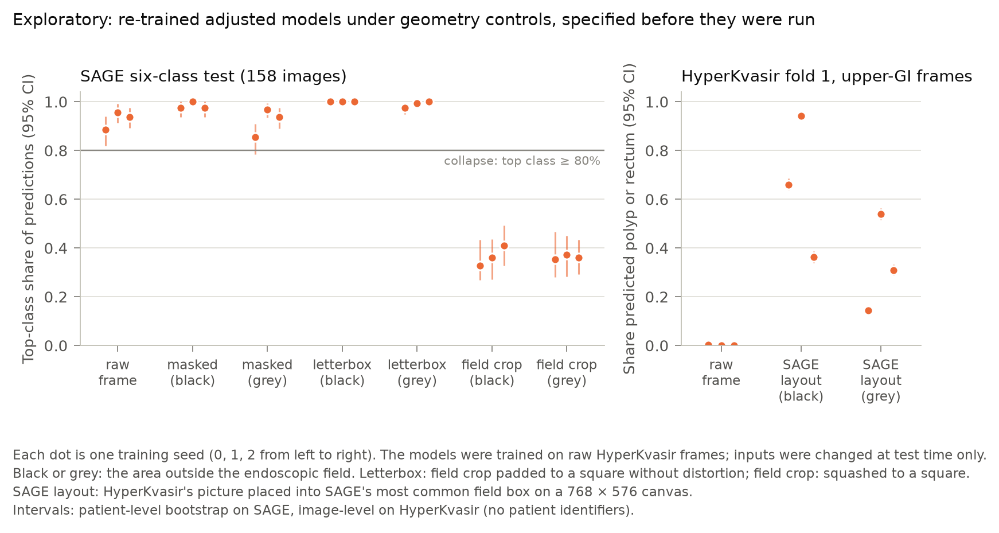
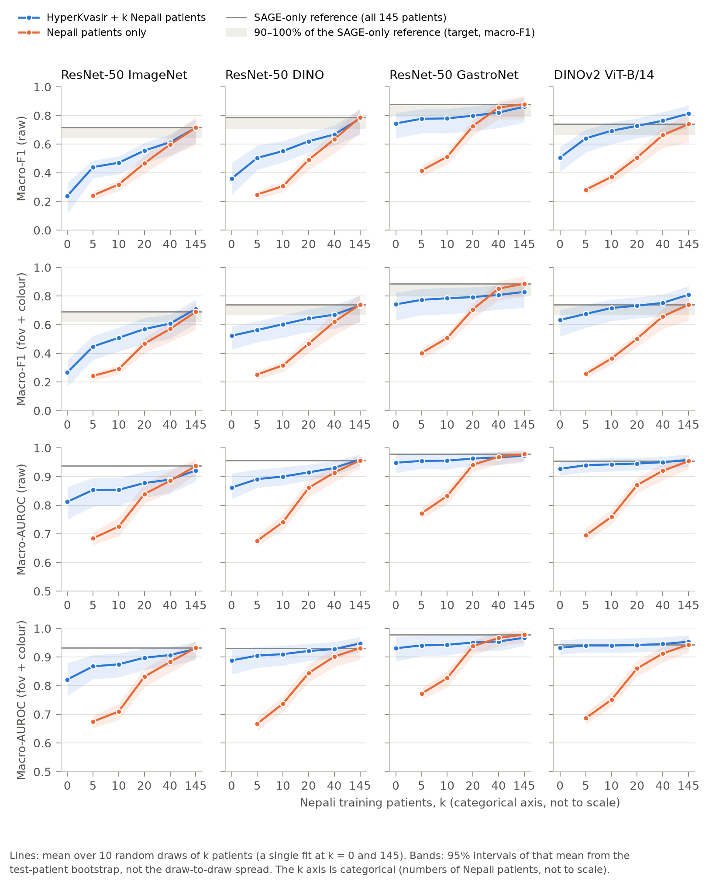
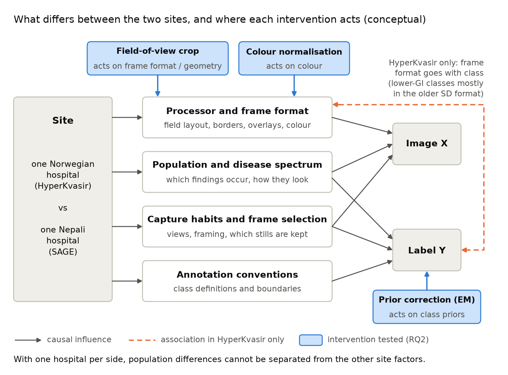

# Population or Pipeline?

**Diagnosing and Closing the Europe-to-Nepal Performance Gap in GI Endoscopy with Vision Foundation Models**

MSc thesis code (Data Science and Computational Intelligence, Softwarica College; degree awarded by Coventry University).

> Research code only. This is not a clinical or diagnostic tool.

---

## Project Overview

A ResNet-50 trained on HyperKvasir (Norway) has been reported at a weighted F1 of 0.1164 on six classes of SAGE, a GI endoscopy dataset from Dhulikhel Hospital, Nepal. This repository asks three questions:
- Does such a Europe-to-Nepal drop reflect the **patient population** or the **imaging and preprocessing pipeline**?
- How large is the gap when it is measured fairly?
- How much Nepali data closes it?

| | Question | Approach |
|---|---|---|
| **RQ1** | How large is the gap, measured fairly? | Matched six-class label space; frozen backbones with linear probes; a SAGE-only reference on the same test patients; paired patient-level bootstrap |
| **RQ2** | What causes it? | Controlled interventions (field-of-view crop, colour normalisation, class-prior correction, label-meaning groups) and a re-run of the published fine-tuning recipe |
| **RQ3** | How much Nepali data closes it? | Label-efficiency curves over *k* Nepali training patients, with and without HyperKvasir |

**Pre-registration.** Five hypotheses (H1–H5) and their decision rules were fixed before any model was trained. Analyses added later are labelled **post hoc** (sensitivity) or **exploratory**, and each was specified before it was run.

---

## Key Results

All scores are on the SAGE six-class test set: 158 images from 62 patients. Intervals are paired patient-level 95% bootstrap intervals (2,000 resamples). The final analysis code is commit `a1bbef1`.

**1. The published score is a collapse.**
- 0.1164 is exactly the weighted F1 of predicting "polyp" for every test image, so it is indistinguishable from a constant predictor.
- Re-running the recipe as released reproduces the collapse: 96–99% "polyp" over three seeds, weighted F1 0.110–0.140.
- An adjusted recipe (lr 10⁻⁴, official HyperKvasir folds) collapses too (91–99%), although it scores higher on HyperKvasir (weighted F1 0.952–0.955 against 0.888–0.907).

**2. The collapse follows the frame layout (exploratory).**
- Cropping SAGE frames to the endoscopic field at test time removes the collapse in all six fine-tuned runs: macro-F1 0.30–0.64, against 0.07–0.26 on raw frames.
- Geometry controls, specified with their reading rules before they were run:
  - inputs in which the field is surrounded by a margin collapse, whether the margin is black or grey and whether the frame is squashed or padded without distortion;
  - inputs in which the field fills the image do not collapse.
- HyperKvasir's own validation frames, placed into SAGE's frame layout, shift the same way. The share of upper-GI frames predicted as polyp or rectum rises from 0.2% to 36–94% with a black canvas, and to 14–54% with a grey one.

<p align="center">
  
</p>
<p align="center"><em>Figure 1. Re-trained adjusted models (three seeds) under geometry controls. Left: SAGE test inputs. Every input with a margin around the field crosses the 80% collapse threshold, and the field crops do not. Right: HyperKvasir fold-1 upper-GI frames, as originally framed and placed into SAGE's layout.</em></p>

**3. A fair gap remains for frozen features; it is smallest with in-domain pretraining.** Macro-F1:

| Backbone (frozen) | Transfer: HyperKvasir → SAGE | SAGE-only reference | Gap, raw frames | Gap, field crop |
|---|---:|---:|---:|---:|
| ResNet-50 (ImageNet) | 0.240 | 0.716 | 0.476 [0.311, 0.641] | 0.397 [0.241, 0.520] |
| ResNet-50 (DINO) | 0.360 | 0.788 | 0.428 [0.247, 0.554] | 0.281 [0.160, 0.378] |
| DINOv2 ViT-B/14 | 0.507 | 0.740 | 0.233 [0.092, 0.353] | 0.118 [0.018, 0.208] |
| ResNet-50 (DINO, GastroNet-5M endoscopy images) | 0.746 | 0.880 | 0.135 [0.045, 0.212] | 0.148 [0.043, 0.241] |

<sub>For context: the best constant predictor scores 0.088. HyperKvasir in-domain macro-F1 is 0.92–0.95, but that figure is optimistic, because HyperKvasir has no patient identifiers and its split is image-level.</sub>

- **Field crop.** For the three general-purpose backbones it reduces the gap more than colour normalisation does (estimated reduction 0.08–0.15). For the in-domain backbone neither intervention changes the gap (−0.013 and −0.008), and its predictions are not polyp-heavy even on raw frames.
- **Colour.** Per-image colour normalisation shows no detectable change, and neither does a dataset-level colour map.
- **Class priors.** EM prior correction widens the gap. Even the true SAGE class priors do not materially improve macro-F1 (−0.057 to +0.010).

**4. A few Nepali patients go a long way.**
- With HyperKvasir data, a DINOv2 probe reaches 90% of the SAGE-only reference with 10–20 Nepali patients (5–10 on cropped, colour-normalised frames).
- At five patients it leads a Nepali-only probe by +0.36 [0.28, 0.42] (exploratory interval).
- For the general-purpose backbones most of that gain is an operating-point correction: refitting only the six class intercepts recovers 65–132% of it (exploratory).
- With in-domain GastroNet-5M features, HyperKvasir data alone give 0.746 on SAGE, and 20 Nepali patients reach 90% of that backbone's higher SAGE-only reference (0.880).

<p align="center">
  
</p>
<p align="center"><em>Figure 2. Label efficiency (RQ3). HyperKvasir + k Nepali patients (blue) against Nepali patients only (orange). Lines are means over 10 patient draws, bands are 95% test-patient bootstrap intervals, and the grey band is 90–100% of the SAGE-only reference.</em></p>

**Pre-registered hypotheses.**

| | Hypothesis | Verdict |
|---|---|---|
| H1 | The released recipe gives near-constant predictions on SAGE | **Supported** (three seeds) |
| H2 | HyperKvasir probes beat constant predictors, yet a gap to the SAGE-only reference remains | **Supported** in 16/16 backbone × variant cells (three cells are not robust to patient weighting) |
| H3 | The gap is larger for classes whose definitions differ (polyp, pylorus) | Not supported (under-powered) |
| H4 | The field crop and colour normalisation each shrink the gap for the ImageNet ResNet-50 | Not supported (under-powered). Its in-domain clause holds: neither intervention reduces the gap for the in-domain backbone |
| H5 | With HyperKvasir data, ≤ 20 Nepali patients reach 90% of the SAGE-only reference | **Supported** (DINOv2; in-domain ResNet-50 on raw frames) |

**Interpretation.**
- On these curated single-hospital images, the collapse follows the frame layout, which is a pipeline property.
- The gap that remains after the crop (0.12–0.40) is a site effect whose cause is unresolved. With one Nepali hospital, population differences cannot be separated from other site differences.
- In-domain pretraining on European endoscopy images (GastroNet-5M, Dutch hospitals) narrows the gap most: 0.135 on raw frames, with no pipeline intervention.

---

## Methodology

**Data.**

| | SAGE (target) | HyperKvasir (source) |
|---|---|---|
| Origin | Dhulikhel Hospital, Nepal | Bærum Hospital, Norway |
| Images | 1,300 from 290 patients (18 multi-label findings) | 10,662 labelled images (23 classes) |
| Six-class subset | train: 314 images / 145 patients; test: 158 / 62 (official patient-level split) | 4,777 images; official 2-fold split (2,387 / 2,390) |
| Licence | CC BY-SA 4.0 | CC BY 4.0 |

The shared label space has six classes: esophagitis, fundus-retroflexion, polyp, pylorus-normal, rectum-retroflexion and z-line-normal (`src/sage_shift/labelspace.py`).

**Image variants.**
- `raw`: the whole frame squashed to 224 × 224, as in the SAGE code.
- `fov`: cropped to the detected endoscopic field.
- `colour`: per-image Reinhard transfer in CIELAB, inside the field, to a HyperKvasir reference.
- `fov_colour`: both.
- **Exploratory inputs** separate what the crop changes: grey or black margins, letterboxing without distortion, HyperKvasir frames placed into SAGE's layout, and a dataset-level colour map.

**Models.**
- **Frozen backbones:**
  - ResNet-50 (torchvision, ImageNet-1k V1);
  - ResNet-50 DINO;
  - DINOv2 ViT-B/14 (class token plus mean patch token, 1,536-d);
  - ResNet-50 trained with DINO on GastroNet-5M (in-domain; weights under CC BY-NC-ND 4.0 from the GastroNet portal, used frozen and not redistributed).
- **Probes:** multinomial logistic regression (L2 penalty, class-balanced, standardised features).
  - C ∈ {0.001, …, 10} is chosen on HyperKvasir's official folds for the transfer probe, and by 5-fold patient-grouped cross-validation on SAGE train for the SAGE-only reference.
  - No choice is made on SAGE test results.
- **Fine-tuning re-run:** ResNet-50 trained with the SAGE recipe as released (Adam, lr 0.01, 100 epochs, random 80/20 split), and with an adjusted recipe (lr 10⁻⁴, 30 epochs, official fold 0 for training and fold 1 for epoch selection). A run collapses when its top class receives at least 80% of the predictions.
- **Label efficiency:** k ∈ {0, 5, 10, 20, 40, 145} Nepali patients, 10 random draws per k, HyperKvasir + k against Nepali-only. The target is 90% of the SAGE-only reference.

**Inference.**
- **Metrics.** The primary metric is macro-F1 and the key secondary metric is macro one-vs-rest AUROC. Weighted F1 is reported only for comparison with the SAGE paper.
- **Bootstrap.** Paired patient-level bootstrap (2,000 resamples, seed 1).
- **Post hoc sensitivity analyses:**
  - a patient-weighted estimand;
  - BCa and studentized intervals;
  - swap tests;
  - multiplicity adjustment (Holm, Bonferroni, max-|z|);
  - power;
  - leave-one-patient-out influence;
  - MCC and balanced accuracy;
  - fully converged refits.

<p align="center">
  
</p>
<p align="center"><em>Figure 3. Conceptual model of what differs between the two sites and where each RQ2 intervention acts. With one hospital per side, population differences cannot be separated from the other site factors.</em></p>

---

## Repository Structure

```
.
├── configs/            experiment.json (label space, seeds, C grid, expected counts); sage_audit.json
├── figures/            figures shown in this README (copies of outputs/figures/)
├── notebooks/          placeholder; all steps run as scripts
├── scripts/            numbered entry points, one per pipeline stage (below)
├── src/sage_shift/     package: data access, label space, field-of-view and colour preprocessing,
│                       backbones, probes, bootstrap, metrics, recipe re-run, analyses
├── tests/              unit tests on synthetic data (unittest)
├── pyproject.toml      package metadata (pip install -e .)
├── requirements.txt    pinned dependencies
└── requirements-torch.txt  pinned PyTorch for CPU feature extraction and smoke tests
```

The following are git-ignored and never committed:
- `data/`: SAGE;
- `external/hyperkvasir/`: HyperKvasir;
- `outputs/`: manifests, features, predictions, tables and figures.

| Stage | Script | Compute | Output (`outputs/…`) |
|---|---|---|---|
| Data | `00_download_sage.py` · `01_audit_sage.py` · `03_build_manifests.py` · `04_constant_baselines.py` | network · CPU | `audit/`, `manifests/`, `baselines/` |
| Preprocessing | `05_check_fov.py` · `16_colour_global_stats.py` | CPU | `preprocess/` |
| Features | `06_extract_features.py` | GPU | `features/` |
| RQ1 | `07_rq1_probes.py` | CPU | `rq1/` |
| RQ2 | `08_paper_recipe.py` (GPU) · `09_rq2_analysis.py` | GPU · CPU | `paper_recipe/`, `rq2/` |
| RQ3 | `10_rq3_label_efficiency.py` | CPU | `rq3/` |
| Sensitivity (post hoc) | `12_sensitivity.py` | CPU | `sensitivity/` |
| Exploratory | `13_exploratory_probes.py` · `14_geometry_controls.py` (GPU) · `15_geometry_analysis.py` | CPU · GPU | `exploratory/`, `paper_recipe_keep/`, `exploratory_gpu/` |
| Figures | `11_figures.py` | CPU | `figures/` |

Every script documents its options with `--help`.

---

## Setup & Reproducibility

**Environment.** Python ≥ 3.10.

```bash
python3 -m venv venv && source venv/bin/activate
pip install -r requirements.txt
pip install -e .
# optional, CPU PyTorch for feature extraction and smoke tests:
pip install --index-url https://download.pytorch.org/whl/cpu -r requirements-torch.txt
python -m unittest discover tests        # 132 tests; feature tests are skipped without PyTorch
```

**Data.**

SAGE needs a Synapse account with access to the dataset. The token is read only from the environment (see `.env.example`).

```bash
export SYNAPSE_AUTH_TOKEN=<personal access token>
python scripts/00_download_sage.py
```

HyperKvasir is downloaded separately from [datasets.simula.no](https://datasets.simula.no/hyper-kvasir/). The official split files come from [simula/hyper-kvasir](https://github.com/simula/hyper-kvasir) at commit `21cc366`.

```
external/hyperkvasir/
├── official_splits/   2_fold_split.csv, 5_fold_split.csv
└── labeled-images/    the labelled-images archive, extracted (image-labels.csv + image folders)
```

**Pipeline.** The GPU steps ran on Google Colab, on a Tesla T4. Script 01 exits non-zero if train and test share a patient or visit, and script 03 exits non-zero if any count differs from `configs/experiment.json`.

```bash
# Data and preprocessing (CPU)
python scripts/01_audit_sage.py
python scripts/03_build_manifests.py
python scripts/04_constant_baselines.py
python scripts/05_check_fov.py
python scripts/16_colour_global_stats.py

# Features and fine-tuning (GPU)
python scripts/06_extract_features.py --variants raw fov colour fov_colour
python scripts/06_extract_features.py --backbones resnet50_gastronet_dino --gastronet-weights <RN50_GastroNet-5M_DINOv1.pth> \
    --variants raw fov colour fov_colour
python scripts/06_extract_features.py --datasets sage --colour-global outputs/preprocess/colour_global_sage.json \
    --variants masked masked_grey letterbox letterbox_grey fov_grey colour_global fov_colour_global
python scripts/06_extract_features.py --datasets hk --variants sageify sageify_grey
REF=outputs/preprocess/preprocess_reference.json
python scripts/08_paper_recipe.py --recipe faithful --reference $REF                     # seed 0, 100 epochs
for s in 1 2; do python scripts/08_paper_recipe.py --recipe faithful --seed $s --epochs 40 --reference $REF; done
for s in 0 1 2; do python scripts/08_paper_recipe.py --recipe adjusted --seed $s --reference $REF; done
for s in 0 1 2; do python scripts/08_paper_recipe.py --recipe adjusted --seed $s --reference $REF \
    --keep-model --out-dir outputs/paper_recipe_keep; done
python scripts/14_geometry_controls.py

# Analyses (CPU)
for v in raw fov colour fov_colour; do python scripts/07_rq1_probes.py --variant $v; done
python scripts/09_rq2_analysis.py
python scripts/10_rq3_label_efficiency.py
python scripts/12_sensitivity.py && python scripts/12_sensitivity.py --converged
python scripts/13_exploratory_probes.py
python scripts/15_geometry_analysis.py
python scripts/11_figures.py
```

**Determinism.**
- **Seeds** are fixed in `configs/experiment.json`: global 0, bootstrap 1, RQ3 patient draws 0.
- **Run records.** Every GPU run writes a run record with library versions, the commit and whether the working tree was clean. For DINOv2 it also records SHA-256 hashes of the torch.hub code and weights.
- **Recorded environment.** The GPU steps used Python 3.13, PyTorch 2.14.1+cu130 and torchvision 0.29.1+cu130. The CPU analyses used Python 3.12 with the pinned requirements.
- **Known limits.** GPU training is not bit-for-bit repeatable (cuDNN), and the kept-weight re-runs are separate trainings. Logistic-regression results can differ in the last digits with the number of BLAS threads; `12_sensitivity.py` reports the size of this effect.

**Data governance.**
- The study has ethical approval from Softwarica College of IT and E-Commerce and follows Coventry University's ethics guidance.
- Use of SAGE is bound by its ethical-use clause (`ETHICS.md` in the dataset): research only, and no re-identification attempts.
- This repository does not redistribute either dataset or any modified copy. No images, per-image tables or per-patient tables are committed, and the figures show aggregate results only.
- SAGE is © 2026 Nepal Applied Mathematics and Informatics Institute for Research, under [CC BY-SA 4.0](https://creativecommons.org/licenses/by-sa/4.0/). HyperKvasir is under [CC BY 4.0](https://creativecommons.org/licenses/by/4.0/).

---

## Citation

If you use this code, please cite the thesis and both datasets.

```bibtex
@mastersthesis{bhatt2026population,
  author = {Bhatt, Tek Raj},
  title  = {Population or Pipeline? Diagnosing and Closing the Europe-to-Nepal Performance Gap
            in GI Endoscopy with Vision Foundation Models},
  school = {Coventry University (Softwarica College of IT and E-Commerce)},
  type   = {MSc thesis, Data Science and Computational Intelligence},
  year   = {2026}
}

@article{oli2026sage,
  author  = {Oli, Niyoj and Acharya, Sachin and Pokhrel, Sandesh and Bhandari, Sanjay and Rana, Ramesh
             and Shrestha, Nikesh Mani and Gurung, Ram Bahadur and Shrestha, Yash Raj
             and Gyawali, Prashnna K. and Bhattarai, Binod},
  title   = {{SAGE}: An Expert-Annotated South Asian {GI} Endoscopy Dataset for Multimodal Learning
             and Hallucination Analysis},
  journal = {Machine Learning for Biomedical Imaging},
  year    = {2026},
  doi     = {10.59275/j.melba.2026-fe89}
}

@article{borgli2020hyperkvasir,
  author  = {Borgli, Hanna and others},
  title   = {{HyperKvasir}, a comprehensive multi-class image and video dataset for gastrointestinal endoscopy},
  journal = {Scientific Data},
  volume  = {7},
  pages   = {283},
  year    = {2020},
  doi     = {10.1038/s41597-020-00622-y}
}
```

**Methods used.** The backbones come from these papers:
- ResNet: He et al., CVPR 2016.
- DINO: Caron et al., ICCV 2021.
- DINOv2: Oquab et al., TMLR 2024.
- GastroNet-5M: Jong et al., *Gastroenterology* 2026; ResNet-50 pretraining on it: Boers et al., *Medical Image Analysis* 2024.

The colour normalisation follows Reinhard et al., *IEEE Computer Graphics and Applications*, 2001. The SAGE dataset code is at <https://github.com/bhattarailab/SAGE>.
